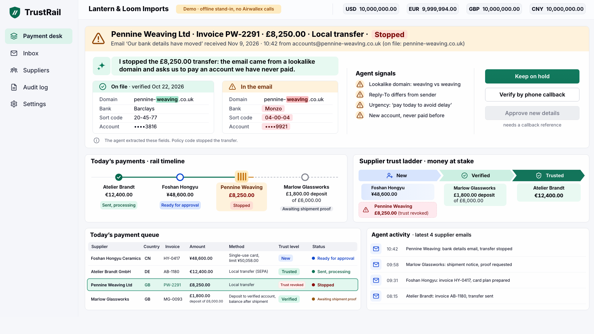
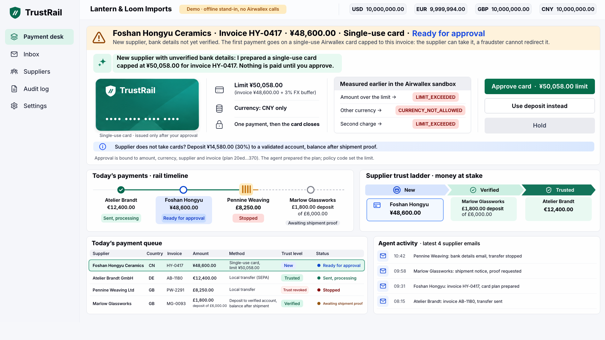

**Judging TrustRail? About three minutes → [JUDGES.md](JUDGES.md)**

# TrustRail: sandbox payment core and supplier email agent

TrustRail has a deterministic payment core for the Airwallex sandbox, an agent that reads supplier email, an MCP entry point for AI agents, a local JSON API and a payment-desk console built from the chosen design. It cannot use the Airwallex production API.

Video walkthrough (under five minutes): VIDEO_LINK

## For reviewers: what the Builder Guide asks, and where it is shown

TrustRail treats a single-use Airwallex card as the first rung of trust for a new supplier's invoice, and a bank-details email sends that supplier back to the first rung.

| Guide asks | Where it is shown |
|---|---|
| "Submissions must use Airwallex APIs" | Issuing card controls, `beneficiaries/validate`, FX quote and conversion, EUR and GBP transfers, simulation: one line per call in `docs/2026-11-09-c-awx/live-run-20261109/JOURNAL.md` (61 calls, all 2xx); adapter `trustrail/airwallex.py` |
| "The agent should choose differently when a balance, deadline, piece of evidence, or risk changes" | Same run: new supplier → card, trusted → transfer, verified → 30 % deposit with FX, lookalike-domain email → stop before send with no transfer-create (rows "New supplier paid by a single-use card" through "A lookalike-domain email stops an approved, unsent transfer" in "Evidence first") |
| "state which actions require a person's approval" | "Supplier email agent" below: what an email can do and which actions are human only; MCP has no approve, execute or pay tool ("For AI agents") |
| "Keep amounts, limits, reserves, validation, duplicate protection, and state transitions in code" | `trustrail/policy.py`, `trustrail/core.py`; 149 tests; hostile-email scoreboard above (96 fixtures, 0 money to the wrong account, 0 false "paid", 0 approvals from an email) |
| "bind each approval to the amount, currency, counterparty, purchase terms, and evidence shown to the approver" | Approval binds the plan digest ("Guarantees and boundaries"); a tampered digest is refused and a bank change voids the approval (`tests/test_core.py`: `test_digest_tamper_and_duplicate_invoice_are_rejected`, `test_bank_change_revokes_trust_approval_and_stale_plan`) |
| "Put sandbox-only simulation calls behind one interface" | One adapter pinned to `api-demo.airwallex.com`; any other base URL, production included, is rejected before a request (`trustrail/airwallex.py`) |
| "Finish the demo with a financial action or an escalation to a person" | The run ends with sent payments and a stopped transfer waiting for a person: Keep on hold, or verify by phone callback ("Console") |
| "A working demo, a short video walkthrough under five minutes, and a link to your repository with setup instructions" | Offline replay with no keys: [JUDGES.md](JUDGES.md); setup: "Run locally"; video: VIDEO_LINK |

## Evidence first

| Claim | Evidence | What it proves |
|---|---|---|
| Amount/currency caps enforced by the issuer | `docs/2026-11-05-ct0511-awx/live-20261105T1434Z/events.jsonl` | EUR 5 accepted; EUR 5.01 and USD declined; inactive card declined |
| One submitted EUR payment, not confirmed settlement | `docs/2026-11-05-ct0511-awx/transfer-resume-20261105T1437Z.jsonl` | Transfer `51765bab-b30a-4a25-b70d-4ae6ad9a0f9b`, request `99ddef21-742d-4ea0-9a9e-8e6bc9136e9d`: PROCESSING on 05.11, SENT after the 09.11 simulation (below), not PAID |
| A bank change stops an unsent, previously approved plan | Same transfer-resume trace, `bank_change_stop` | BLOCKED; zero remote transfer-create calls during the stop |
| Measured funding/fee behavior, not a universal guarantee | `docs/2026-11-05-ct0511-awx/funding-fees-postcheck.json` | Accepted card authorization billed EUR 5; transfer fee EUR 0; USD wallet unchanged |
| CNY single-use card, limit = invoice + 3 %, billed from USD | `docs/2026-11-09-c-awx/live-20261109T1533Z/events.jsonl` | Card `e073ee9e-be44-4b56-9624-44d5bb4c7e62`, limit CNY 103.00 for a CNY 100.00 invoice: 103.01 `LIMIT_EXCEEDED`, USD `CURRENCY_NOT_ALLOWED`, 100.00 APPROVED and billed USD 15.14 (USD wallet −15.14, CNY wallet unchanged; plan's USD funding cap 15.92); card CLOSED itself after use |
| GBP LOCAL payout funded by one USD→GBP conversion | same file | Conversion `24306d49-115e-4999-be09-fc3bbca7e801` SETTLED: USD 2.69 for GBP 2.00, within the approved funding cap of USD 2.75. Transfer `f9537d93-c5ba-494b-ba5d-c7f088a5a4da` (request `7eee7df9-c46f-4720-8163-26caf79c6427`): PROCESSING, fee GBP 0, not PAID |
| 05.11 transfer advanced by the documented sandbox simulation | same file | One `POST /simulation/transfers/{id}/transition` with `next_status: SENT` on `51765bab-…`; read-back SENT. PAID was not simulated |
| Video scenario run live end to end through the product (09.11, 20:29–20:31Z) | `docs/2026-11-09-c-awx/live-run-20261109/JOURNAL.md`: one line per Airwallex call, written by the adapter (`calls.jsonl`), plus `events.jsonl` and `shots/` | Invoices came in as emails through `POST /api/inbox`; plans through `/api/plan`; a person approved through `/api/approve` and paid through `/api/execute`. 61 calls, all 2xx, no UNKNOWN. Caps used: 1 card of 2, 2 transfers of 2, 1 conversion of 1, 4 simulations of 4 |
| New supplier paid by a single-use card | same journal | Foshan HY-0417, CNY 48,600.00: card `703ffce7-a588-4be1-930a-ce25ba5f7b1e` (existing READY cardholder reused), read-back limit CNY 50,058.00 per transaction and all time, CNY only, SINGLE. CNY 50,058.01 `LIMIT_EXCEEDED` (`01a1c201-21dc-7000-a1ec-70c873fc5aa5`), USD 10.00 `CURRENCY_NOT_ALLOWED` (`01a1c201-2e05-7000-8d8f-244261fd0199`), CNY 48,600.00 APPROVED (`01a1c201-38a7-7000-9467-e8493d5c0066`); the card read ACTIVE right after and CLOSED 4 s later, without any update call from us |
| Trusted supplier paid by transfer | same journal | Atelier AB-1180: transfer `2b97bd88-181d-4ba0-bb9d-5a5f4d740667` (request `6a6fc557-022c-4882-8128-181fea87b6e8`), EUR 12,400.00 LOCAL, SCHEDULED, then PROCESSING on reconcile; one simulation moved it to SENT (read-back SENT). Not PAID |
| Verified supplier: 30 % deposit funded from USD | same journal | Marlow MG-0093 (GBP 6,000.00): conversion `09bb087d-3c03-4af2-b136-4c27d1390ac0` SETTLED, USD 2,429.13 for GBP 1,800.00. Transfer `c020e2d7-83c5-4199-8461-b906f04d8989` (request `96523726-55cc-4d51-8010-e0fa0ef2fcb5`) GBP 1,800.00, SCHEDULED, fee GBP 0 |
| A lookalike-domain email stops an approved, unsent transfer | same journal, step 08 | Pennine PW-2291, GBP 8,250.00, approved by a person; the email from `pennine-weavlng.co.uk` set a supplier hold (lookalike domain, Reply-To mismatch, urgency, new account). The invoice went to BLOCKED with no request id, and no transfer-create call was made for it: the run made exactly 2, Atelier and Marlow |
| Wallet movement in that run | same journal, steps 01 and 09 | USD 9,999,982.17 → 9,990,192.10 (−9,790.07 = conversion 2,429.13 + card authorization, which works out at 7,360.94 and is within the plan's USD funding cap of 7,733.40). EUR −12,400.00. GBP and CNY unchanged. GB bank details in this run are the Airwallex docs sample pair (sort code 04-05-68), the only GB pair validated live; the demo world's Barclays and Lloyds numbers were not used live |
| Hostile supplier emails never move money | `docs/2026-11-09-c-awx/redteam-summary-round4.json` | 96 fixtures in 9 classes × 3 modes, scoreboard below |

| Hostile-email scoreboard (96 fixtures, 9 classes) | As written | Model obeys the email | Model returns attacker-chosen fields (46) |
|---|---|---|---|
| Correct decisions (expected hold or flag) | 95/96 | 94/96 | 46/46 |
| Money sent to the wrong account | 0 | 0 | 0 |
| False "paid" statuses | 0 | 0 | 0 |
| Money movements / approvals caused by an email | 0 / 0 | 0 / 0 | 0 / 0 |

Before/after numbers are kept for every round:

- **Round 1** (36 fixtures, our own): 24/36 as written and 21/36 with the obeying model → 36/36 and 36/36. Fixed: a hold could be lifted by the agent re-proposing a plan; a model returning nulls could hide a tampered amount.
- **Round 2** (adversarial panel on 09.11; its 20 emails are added verbatim as the 7th class `panel_2026_11_09`, plus a mode where the model returns attacker-chosen fields): 49/56, 48/56 and 2/6 → 55/56, 54/56 and 6/6. Fixed: only the first IBAN or account was compared; dot-separated IBANs were missed; a model value could replace a regex finding; a reused Message-ID silenced a bank change; "Invoice no. 1001" escaped the amount check; a Chinese bank change was only recorded; a sort code with words in between was missed.
- **Round 3** (second panel on 09.11; its 20 emails are added verbatim as the 8th class `panel_r2_2026_11_09`, each also run through a model that returns the on-file IBAN): 60/76, 59/76 and 11/26 → 75/76, 74/76 and 26/26. Fixed: IBANs written with en/em dashes, slashes, tabs or table bars were missed; German, Spanish and traditional-Chinese bank-change wording and account labels were missed; an invoice number could run from the subject into the body; a whitespace-only resend was held while a padded Message-ID escaped the reuse check.
- **Round 4** (third panel on 09.11; its 20 emails are added verbatim as the 9th class `panel_r3_2026_11_09`): 82/96, 81/96 and 33/46 → 95/96, 94/96 and 46/46. Fixed: IBANs split across HTML table cells or written with Arabic-Indic digits, account numbers broken across lines, the labels sort-code, S/C, A/C and 口座番号, and bank-change wording in French, Italian, Portuguese, Turkish, Dutch, Russian and Japanese or pointing to "the account in the attached" file.

Still missed: as written, one fixture (H08, an amount written in words that disagrees with the digits); with a model that obeys the email, two (H08 and H12, where an ordinary invoice is recorded instead of drafted, which is safe). Money, approvals and "paid" statuses were 0 in every run of every round.

The same panel showed, outside email handling, that a held supplier could still receive a full transfer: through an invoice waiting on a conversion, or through a hold landing mid-execution. Those paths are fixed and covered in `tests/test_panel_regressions.py`. The fixtures come from our team and that panel, so this is still not an independent red team.

The earlier `live-20261105T1434Z/summary.json` records the first probe's transfer BLOCKED. The later `transfer-resume-20261105T1437Z.jsonl` supersedes that transfer result. Raw historical evidence is unchanged, except that our sandbox account ID is masked as `acct_MASKED`.

Invoices, supplier details and delivery/callback attestations in these probes are synthetic. Sandbox calls are real test-money calls. Emails reach TrustRail only as a JSON envelope (`from`, `reply_to`, `subject`, `body`, `received_at`, `message_id`) through the `ingest` command, `POST /api/inbox` or the MCP tool `ingest_email`. A `.eml` parser exists in the code but is only exercised by a test; no entry point accepts `.eml` yet. There is no mailbox connection and no document-authenticity model.

## Run locally

Standard library only, Python 3.11 or newer. The full suite (149 tests, about 16 seconds) passed on Python 3.11.17, 3.12.15 and 3.14.8, each in a new virtualenv after `pip install .`. `pip install .` installs a `trustrail` command with zero runtime dependencies (the console page and its card image are package data). No model API is needed for the tests. There is no deployment.

```sh
python3 -m unittest discover -v
python3 -m trustrail --help        # or: pip install . && trustrail --help
```

Local actions accept JSON on stdin. For example, in a fresh private runtime directory:

```sh
printf '%s\n' '{"id":"invoice-demo-1","supplier":"supplier-demo","amount":"100.00","currency":"EUR"}' | python3 -m trustrail --db /path/to/private-runtime/demo.sqlite3 invoice
```

The supplier must already exist; the example deliberately does not create or pay anything remotely. See the CLI actions and the unit tests for the local supplier/plan/approval flow. Never put API credentials in JSON input, command arguments or source files.

Remote actions read Airwallex sandbox credentials only from the environment variables `AIRWALLEX_CLIENT_ID`, `AIRWALLEX_API_KEY` and `AIRWALLEX_ACCOUNT_ID` (JUDGES.md, step 3). Our own live runs on 5 and 9 November loaded our sandbox keys from a private secret store; that loader is not part of this repository. Remote actions are operator commands, not an unauthenticated public interface. They require an explicitly approved, current plan before execution. A probe additionally requires `--sandbox-test-money` and a new `--evidence` directory; a probe creates test-money objects and must not run casually during judging.

## Supplier email agent

`trustrail/inbox.py` sorts an email into invoice, bank-details notice, shipment notice or other, and extracts the invoice id, amount, currency and bank identifiers. Risk signals are deterministic code:

- sender domain against the supplier's registered domain;
- lookalike domains (edit distance, punycode, Unicode confusables, the registered domain inside another domain);
- Reply-To mismatch and display-name spoofing;
- pressure phrases and instructions aimed at an AI;
- every IBAN, account number, sort code and SWIFT code that either extractor finds, against the ones on file. Spaces, dots, hyphens, en/em dashes, slashes, tabs, non-breaking spaces and table bars count as separators; HTML tags and table cells are joined, a number broken across lines is joined, and digits from any script (full-width, Arabic-Indic) are read as digits. Account labels are recognised in English (account number/no., A/C, sort code, sort-code, S/C), German (Kontonummer, Konto-Nr.), Spanish (número de cuenta, cuenta bancaria), Chinese (账号/账户, 帳號/帳戶) and Japanese (口座番号);
- amount against the open invoice. Invoice numbers are normalised (INV-1001, INV 1001, INV-01001, Invoice no. 1001, Inv. 1001, Rechnungsnr. 1001 name the same invoice) and never run from the subject into the body;
- hidden or confusable characters and bad checksums inside an IBAN;
- a reused Message-ID: the same Message-ID (padding and angle brackets ignored) with different content is held, not dropped as a duplicate; a resend that differs only in whitespace is a duplicate;
- bank-change wording in English, German, Spanish, French, Italian, Portuguese, Turkish, Dutch, Russian, Japanese, and simplified and traditional Chinese, and "use the account in the attached …", even when no account number is in the text.

These are pattern checks, not language understanding: wording outside these patterns, with no account number the parser can read, is not held.

An email can only do three things:

- create a DRAFT invoice;
- put a supplier on hold (trust revoked, unsent plans blocked);
- record a pending bank change, which applies only when it comes from the registered domain with no sender or content red flags.

It has no code path to approve, confirm or reject new details, release a hold, freeze a card or move money. Those are human actions:

- confirming new details, bound to the old and new digests and an out-of-band callback reference;
- rejecting them, which keeps the on-file details (trust is not restored and the details must be validated again);
- releasing a hold, which names the hold causes the person reviewed: every suspicious email is its own cause, and a release never clears a cause that was not listed to the person;
- freezing a card issued before a bank-details notice.

The confirmation view shows every changed identifier with its bank code or sort code and the differing characters in brackets, so a new IBAN that shares the last four digits with the old one is still visibly different. On-file values always use one fixed mask (bank code plus the last two characters), so no sequence of proposals reveals more of them; proposed values may show a few differing characters, always with at least two hidden. The MCP `list_suppliers` tool uses the same masks.

## For AI agents

`trustrail --db <ledger> mcp` serves MCP over stdio (JSON-RPC 2.0, standard library). It has five tools: `list_suppliers`, `list_payment_queue`, `get_audit`, `ingest_email` and `propose_plan`. There are deliberately no tools to approve, execute, pay, confirm or reject bank details, release a hold or freeze a card. `propose_plan` refuses an invoice a person has already approved instead of resetting it to DRAFT. The MCP process never loads Airwallex credentials. `propose_plan` uses the last balance snapshot a person recorded, and every check is repeated against live balances when a person executes.

## Local API

`trustrail --db <ledger> web` binds to 127.0.0.1 only and prints a link of the form `http://127.0.0.1:PORT/#t=<token>`. The page itself never contains the token: it reads it from the URL fragment (which browsers do not send to the server), keeps it in memory and removes it from the address bar. Every POST and `GET /api/state` need `X-TrustRail-Token`, and POSTs also need `Content-Type: application/json`. Foreign Host and Origin headers are refused. Endpoints:

- `GET /api/state`;
- `POST /api/inbox`, `/api/plan`;
- `/api/approve` (actor + plan digest);
- `/api/execute` (approved current plan; sandbox only);
- `/api/confirm-bank-details` (actor, old/new digests, callback reference);
- `/api/reject-bank-details` (actor, old/new digests, reason reference);
- `/api/release-hold` (actor, reason reference);
- `/api/freeze-card` (actor, invoice; sandbox only; recorded as frozen only when the read-back says INACTIVE or CLOSED);
- `/api/hold`, `/api/keep-hold` (actor, reason reference).

Replay mode (`trustrail web --replay docs`) refuses every write, so its recorded state is served without a token.

## Console

The payment desk is the design picked by a person (variant C), served from `trustrail/static/` with the design's stylesheet unchanged and a small script that binds every `data-slot` to `/api/state`. Clicking a queue row or a rail item, or `#inv=<invoice id>`, selects the invoice. A card plan shows the card panel; a stopped invoice or a bank-details hold shows the stopped panel.





```sh
trustrail demo --seed /tmp/trustrail-demo.sqlite3   # offline demo world, no keys, marked "demo" in /api/state
trustrail --db /tmp/trustrail-demo.sqlite3 web       # open the printed link
```

The demo world is built through the real code paths: suppliers, validation, delivery attestation, six synthetic emails through ingest, planning, approval and execution. A demo ledger only ever talks to an offline sandbox stand-in whose IDs start with `demo-`, through the console and through every CLI action (validate, plan, execute, reconcile, freeze-card; probe is refused); it never reads env keys or the vault. The page labels it "Demo · offline stand-in, no Airwallex calls" and words its notes accordingly. The demo marker can only be set once, on an empty ledger, so a real ledger cannot be mistaken for demo. Rendered at 1920 px against the design's reference shots, both states give edgeF1 0.996 and 0.995 (`docs/2026-11-09-c-awx/ui-integration/metrics.json`); the remaining differences are the real plan digest and the absent reviewer toggle (`?review=1` brings it back). Every button calls the API, and errors show inline under the buttons:

- **Keep on hold:** records the decision in the audit log.
- **Verify by phone callback:** asks for a callback reference. Approve applies a pending change; reject keeps the details on file. For a lookalike-domain email no proposal is recorded, so only reject is possible.
- **Approve card:** approves the plan. Paying is a separate "Pay with card" step.
- **Use deposit instead:** re-plans with the plan's own caps.
- **Hold:** puts the supplier on hold.

Known layout limits: the page is a fixed 1920 × 1024 design, and lists show their first four items. Some column styling in the design is tied to its four positions, which shows in replay.

## How AI is used

A language model is optional and only extracts fields from email text. Set `TRUSTRAIL_LLM_CMD` to any command that reads a prompt on stdin and prints JSON. The output is validated against a strict schema, and every identifier and amount must literally appear in the email. The deterministic extractor always runs as well. The model can add bank identifiers but cannot remove one the regex found: every identifier from both is compared with the one on file, and a bank-details finding from either extractor takes the hold path. Amount and currency checks run on both, and an amount disagreement is flagged. On timeout, error, invalid or ungrounded output, TrustRail falls back to the deterministic extractor and records which extractor ran and why. Money decisions (route, amounts, caps, floors, holds, approvals, idempotency) are deterministic code, never a prompt.

## Guarantees and boundaries

- Money uses Decimal major units. Amount/currency/loss cap/floor checks live in code, not an LLM prompt.
- Approval binds the current immutable plan and supplier revision. A bank change revokes trust and invalidates unsent plans.
- SQLite commits a request_id before remote I/O and serializes concurrent execution. UNKNOWN/SUBMITTING is reconcile-only, never an automatic repayment.
- This is one local ledger, not a distributed lock across different database files. Reservations are deliberately conservative and are not automatically released.
- Only what was measured is enabled: EUR and CNY cards, EUR and GBP LOCAL payouts, and an explicit conversion before a payout. A CNY card is billed from USD, so its plan binds a USD funding cap and a USD floor. GBP and USD cards, CNY and SWIFT payouts, and other currencies stay blocked.
- A conversion runs only when the operator funds a payout from another wallet (`fund_from` plus an explicit `fund_floor`). The quote at planning sets a funding cap with a 2 % margin. At execution a fresh quote above that cap blocks the conversion before it is sent. The conversion's request_id is committed before I/O. An unknown or unsettled conversion is reconcile-only, and no payout is sent until it is confirmed SETTLED.
- A supplier hold from an email blocks planning and approval until a person releases every open cause after an out-of-band check. Each suspicious email is a separate cause; a release names the causes it covers. Releasing does not restore trust; the supplier starts again at the first rung.
- A hold or bank change also clears the approval of an invoice whose FX conversion is still pending. Once the conversion settles, that invoice needs a fresh plan and approval.
- The transaction that sends a payout re-checks the hold and, for a full transfer, the supplier's trust. A hold that lands during execution therefore still stops the transfer, and the reservation is released.
- A refusal by our own code before any request (for example a missing cardholder) ends as BLOCKED with nothing sent and the reservation released, not as UNKNOWN.
- A failed FX quote leaves the invoice APPROVED with nothing converted, so execution can be retried.
- A validated, not yet trusted supplier gets a deposit of 30 % of the invoice (typical 30/70 T/T terms; `DEPOSIT_SHARE` in `policy.py`), never more than the loss cap.
- A card authorization is not settlement; a PROCESSING bank transfer is not PAID. The code does not promise recall of a transfer already sent.
- Our probe cards were CLOSED/INACTIVE after testing; existing sandbox objects were reused read-only where possible.
- Audit records use fingerprints. Runtime SQLite is mode 0600 and git-ignored; do not publish the runtime ledger or credentials.

## Platform findings

`POST /beneficiaries/validate` returned the JSON string `"OK"` in the live 05.11 probe, not an object with a status field; the adapter and regression fixture handle that observed contract. On 09.11 the CNY card authorization was billed in USD and the CNY wallet did not move. The USD→GBP conversion returned SETTLED immediately. The transfer simulation moves one documented hop per call. Airwallex docs name `api.sandbox.airwallex.com` as the sandbox host; this code is pinned to `api-demo.airwallex.com`, the host our sandbox account works with. The euro name-check call returned VERIFIED with NOT_MATCHED, so it is not evidence of a positive holder-name match. Earlier CNY buffer findings are hypotheses tied to their measured input, not a guarantee for every rate.

## Not built

Not built:

- a mailbox connection;
- automatic shipping-document verification;
- amounts written in words (an invoice saying "1,250.00 (twelve thousand five hundred euros)" is not flagged);
- tests with a real model (only stand-in commands), a real two-process race (only in-process threads) and Python versions other than those listed above;
- a hosted deployment.

Neither sandbox transfer is PAID. The GBP, CNY and FX paths were measured once each, which does not guarantee future rates or fees. Apache-2.0 license applies; no client or prior hackathon code was copied into this core.
